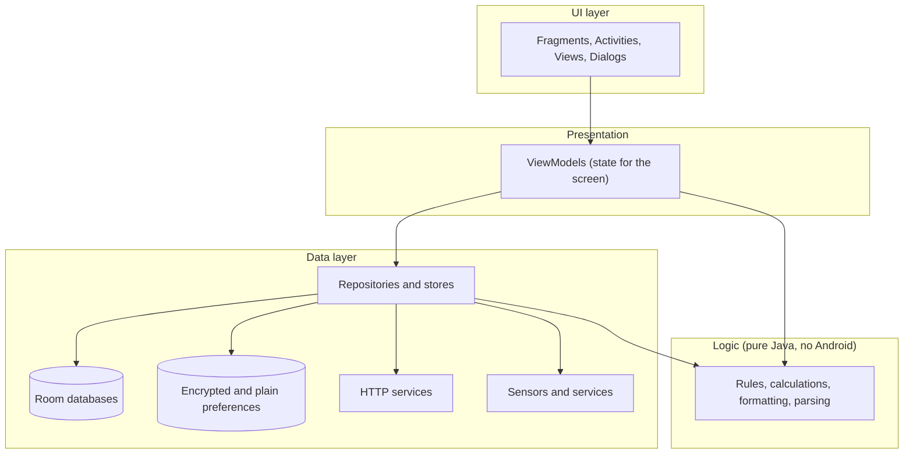
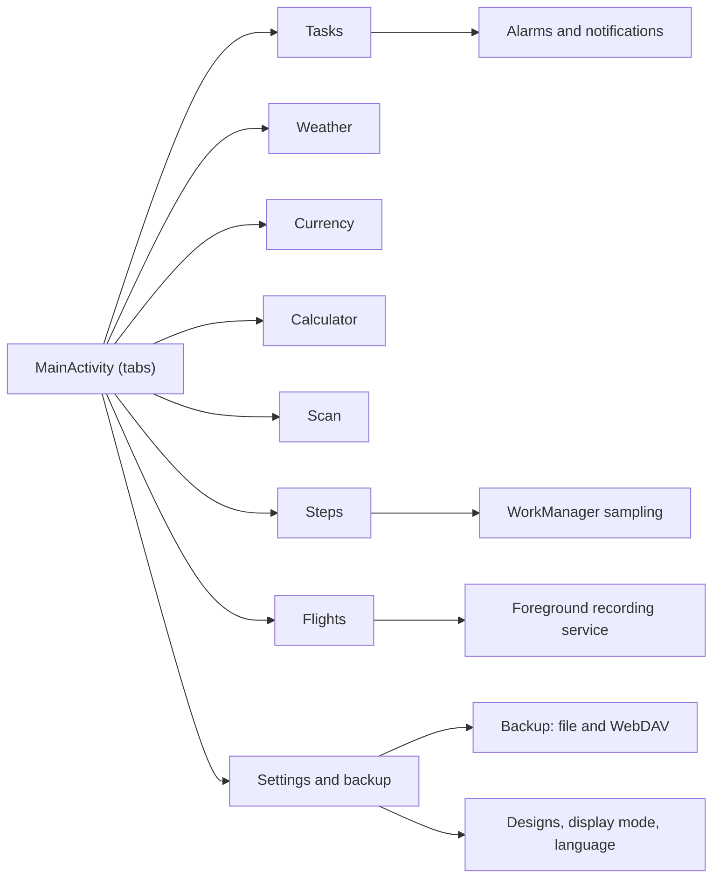

# MyAssistant

**Seven everyday tools in one Android app: tasks, weather, currency, calculator, document scanner, step counter and a flight instrument panel.**
No ads. No trackers. No account. Available in 38 languages, including right-to-left ones.

[](#requirements)
[](#languages)
[](#terms-of-use)
[](LICENSE)

---

## Contents

1. [Why MyAssistant](#why-myassistant)
2. [Features by module](#features-by-module)
3. [Look and feel](#look-and-feel)
4. [Privacy and security](#privacy-and-security)
5. [Architecture](#architecture)
6. [Project structure](#project-structure)
7. [Download and install](#download-and-install)
8. [Build from source](#build-from-source)
9. [Terms of use](#terms-of-use)
10. [License and copyright](#license-and-copyright)
11. [Support](#support)

---

## Why MyAssistant

One app instead of seven. Everything is built around the same ideas:

- **Simple and fast.** Native Android (Java), no heavy frameworks, no work on the main thread that can block it.
- **Private by design.** No advertising, no analytics, no sign-up. Your tasks, steps, scans and flights stay on your phone.
- **Yours to keep.** Back everything up to a file or to your own WebDAV cloud storage and restore it on another phone.
- **For everyone.** 38 languages, dark and light mode, ten visual designs, and full right-to-left support.
- **Paid once.** One purchase, no subscription, no in-app advertising.

## Features by module

### Tasks
- To-do list with three levels of importance: normal, important, urgent.
- Deadlines with a day counter ("3 days left", "2 days overdue") and reminders with exact date and time.
- Reminders arrive as notifications, as a full-screen alert, and optionally as a spoken voice alert.
- Reminders survive a phone restart.
- Filter (all, in progress, done, warnings) and sort (A-Z, status, creation, edit or completion date, importance, deadline).
- Progress statistics: total, done, left, percent.
- Optional creation and edit timestamps on every task.

### Weather
- Current weather for your location or for any city found by name in any language.
- Temperature, feels-like, humidity, wind, today's range, moon phase and illumination.
- A live animated beach scene that changes with the weather and the time of day: sun, clouds, rain, snow, fog, lightning, stars and the phases of the moon.
- Units of your choice: Celsius or Fahrenheit, m/s or km/h.

### Currency
- Converter for world currencies with a one-tap swap.
- Rates are cached, so the last known rates are shown offline, with the date of the last update.
- Remembers your last pair.

### Calculator
- Basic and scientific modes with a history of calculations and memory.
- Degrees and radians.
- Clear error messages instead of silent failures (division by zero, too large, undefined).

### Scan
- Photograph a page or pick pictures from the gallery.
- Automatic document edge detection, manual crop, perspective correction.
- Filters: colour, grey, black and white; shadow removal, brightness, contrast and sharpness.
- Multi-page documents; reorder, delete and rename pages and documents.
- Export and share as PDF or JPEG, in standard paper sizes or the original proportions.

### Steps
- Counts steps in the background with the phone's built-in step sensor.
- Splits walking and running by cadence.
- Distance from your own step lengths, with a guide for measuring them.
- Statistics for the last 7 days, 30 days, the month or any dates you choose: total, average per day, best day, active days.

### Flights
- Flight instrument panel for paragliding, hang gliding and light aviation, for fun and curiosity: speed, altitude, compass, artificial horizon, G-force and a variometer with sound.
- Records the route in the background and keeps a flight journal.
- Creates a PDF report for every flight: route map, altitude and speed profile, key figures.
- Units for speed, altitude and climb rate, and a configurable limit for stored reports.
- Not for navigation or anything related to safety.

### Backup and settings
- Export and import a full backup as a file (device storage, SD card, USB, Drive) or share it to any app.
- Optional cloud backup to your own WebDAV storage, one-tap save and restore, and an optional daily automatic backup. The password is kept in encrypted storage.
- Language, display mode (light, dark, automatic), ten application designs, alarm and permission settings.

## Look and feel

Ten designs, each with its own colours, shapes and character, working in light and dark mode:

| | | | | |
|---|---|---|---|---|
| Classic | Paper and Ink | Pastel Cloud | Neon Arcade | Toon |
| Biker | Cockpit | Beach | Magic Forest | Mono Block |

## Privacy and security

- **No advertising and no tracking.** The app contains no ad network and no analytics.
- **No account.** Nothing to sign up for.
- **Your data stays on the device.** Tasks, steps, scans and flights are stored locally. They leave the phone only when you export a backup or turn on your own cloud backup.
- **Internet is used only for what you ask for:**
  - weather: MET Norway (Norwegian Meteorological Institute, CC BY 4.0), loaded with an identifying User-Agent and cached until the time the server says;
  - city search and place names: the bundled GeoNames list of cities (CC BY 4.0), built by `tools/cities/build_cities.py`, no network;
  - exchange rates: Exchange Rate API;
  - map imagery in flight reports: Esri;
  - your own WebDAV server, only if you configure it, and only over HTTPS.
- **Credentials are encrypted.** The cloud password is stored with Android's encrypted preferences.
- **Permissions are requested when needed** and explained in the app: notifications, exact alarms, location (weather and flights), physical activity (steps).

## Architecture

The app is a single-activity Android application with a tab per module. Every module follows the same layers, so each one can be read and tested on its own.



Rules the code follows:

- **Single responsibility.** One class, one reason to change.
- **Feature packages.** Code is grouped by feature, and inside a feature by role.
- **Pure logic is separate.** Rules and calculations have no Android dependencies, so they are covered by unit tests.
- **Language-neutral logic.** Logic returns stable keys; the UI turns them into text from resources, so every language works the same way.
- **No blocking of the main thread.** Database, network, file and PDF work run on background executors; recurring work goes to WorkManager; recording runs in a foreground service.



### Technology

| Area | Choice |
|---|---|
| Language | Java 11 |
| Minimum / target Android | 7.0 (API 24) / API 37 |
| UI | Material Components, ConstraintLayout, custom drawn views |
| Storage | Room 2.6 with migrations, encrypted preferences |
| Background work | WorkManager, foreground service, exact alarms |
| Localization | per-app language (`AppCompatDelegate`), 38 languages, right-to-left |
| Tests | JUnit unit tests for the logic of every module and for translations |

## Project structure

```text
MyAssistant/
├── app/
│   └── src/
│       ├── main/
│       │   ├── java/com/yurii/pavlenko/myassistant/
│       │   │   ├── MainActivity.java            single activity with tabs
│       │   │   ├── MyAssistantApp.java          application start-up
│       │   │   ├── tasks/                       model, database, logic, repository,
│       │   │   │                                notifications, receivers, ui, viewmodel
│       │   │   ├── weather/                     data, location, logic, ui (+ animated scene), viewmodel
│       │   │   ├── currency/                    data, logic, ui, viewmodel
│       │   │   ├── calculator/                  engine, logic, data, ui, viewmodel
│       │   │   ├── scan/                        imaging (filters, edge detection), export,
│       │   │   │                                files, database, repository, ui, viewmodel
│       │   │   ├── steps/                       sensor, work, logic, database, data, ui, viewmodel
│       │   │   ├── flights/                     sensor, audio, service, logic, database, data,
│       │   │   │                                report (PDF, maps, charts), ui, viewmodel
│       │   │   ├── backup/                      file backup, WebDAV cloud backup, menus
│       │   │   ├── network/                     shared HTTP helper
│       │   │   └── ui/                          navigation, theme and designs, locale, widgets
│       │   └── res/
│       │       ├── layout/, layout-land/        portrait and landscape layouts
│       │       ├── values/                      default (English) texts, colours, styles
│       │       ├── values-<language>/           translations, 37 languages
│       │       └── xml/locales_config.xml       list of app languages
│       └── test/                                unit tests (logic and translations)
├── tools/
│   ├── coastline/                               builds the coastline data for flight maps
│   └── designs/                                 builds the artwork of the designs
├── build.gradle.kts, settings.gradle.kts, gradle/
├── LICENSE
└── README.md
```

## Languages

English (default), Українська, Русский, עברית, العربية, Español, Français, Deutsch, Italiano, Português, Polski, Nederlands, Türkçe, Čeština, Slovenčina, Română, Magyar, Български, Ελληνικά, Српски, Hrvatski, Svenska, Dansk, Norsk bokmål, Suomi, हिन्दी, বাংলা, اردو, فارسی, 简体中文, 繁體中文, 日本語, 한국어, Tiếng Việt, ไทย, Bahasa Indonesia, ქართული, Հայերեն.

Choose the language in **Settings → Language**. Right-to-left languages (Hebrew, Arabic, Persian, Urdu) mirror the interface automatically. Translations are reviewed by native speakers over time; if you find a mistake, please open an issue.

## Requirements

- Android 7.0 (API 24) or newer.
- A step sensor for the step counter; GPS and a barometer (if present) for flights; a camera for scanning.

## Download and install

**From Google Play (recommended).** Search for **MyAssistant** in Google Play, or open the link on the project page, and purchase it once. Updates arrive automatically.

**Install from a file (APK).** Only for builds you received from the author:

1. Download the `.apk` file to your phone.
2. Open it. If Android asks, allow installing from this source (Settings → Apps → Special access → Install unknown apps).
3. Tap **Install**, then open **MyAssistant**.
4. On first start, allow the permissions you want to use. Every module works without the ones it does not need.

Remember to switch **Install unknown apps** off again afterwards.

## Build from source

The source code is published so that you can read it and check what the app does. Building and distributing it is covered by the [license](LICENSE).

Requirements: Android Studio (current stable), JDK 17 or newer for Gradle, Android SDK with API 37.

```bash
git clone https://github.com/YuriiJavaDev/MyAssistant.git
cd MyAssistant
./gradlew assembleDebug     # debug APK in app/build/outputs/apk/debug/
./gradlew test              # unit tests
```

## Terms of use

- **No advertising.** MyAssistant contains no ads and never will in the paid version.
- **No data selling.** Your data is never sold or shared for marketing.
- **Entertainment instruments.** The flight instruments, step counter, weather and exchange rates are informational. Do not rely on them for navigation, flying, safety, medical or financial decisions. The author is not responsible for decisions made using them.
- **Third-party data.** Weather by MET Norway, places by GeoNames (CC BY 4.0), exchange rates by Exchange Rate API, coastlines by Natural Earth (public domain), imagery by Esri and its providers. They keep their own terms.
- **Fair use of the license.** See below.

## License and copyright

Copyright © 2026 Yurii Pavlenko. All rights reserved.

MyAssistant is **proprietary software, sold under a single-purchase license**. In short:

- You buy it once and may use it on your own devices for personal purposes, without time limits and without a subscription.
- You may not copy, resell, rent, sublicense, redistribute, publish modified or unmodified builds, or remove the author's notices.
- You may not reverse engineer it, except where the law explicitly allows it.
- The software is provided "as is", without warranty. Bug reports are welcome and are fixed where possible, but without any obligation or deadline.

The full legal text is in [LICENSE](LICENSE).

## Support

Questions, bug reports and translation fixes: open an issue at https://github.com/YuriiJavaDev/MyAssistant/issues. Please include your Android version, phone model and the language you use.
